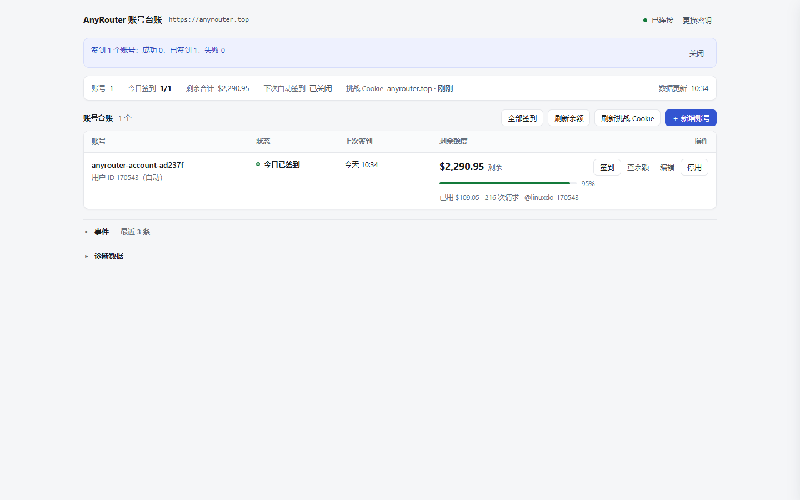

# anyrouter — CLIProxyAPI 插件

把 AnyRouter 的两件事搬进 CPA 进程内：

1. **多账号 Cookie 签到**（原 `anyrouter签到脚本.txt`）：账号池、每日定时签到、手动补签、结果分类与历史。
2. **余额查询**（原 Deno 版 `anyrouter余额查询/main.ts`）：自动执行加速乐（JSL）挑战页算出 `acw_sc__v2` 动态 Cookie，再读 `/api/user/self`，余额既显示在插件面板，也通过 `quota_provider` 显示在 CPA 凭证页。

与原脚本的差别：不再需要 cron、不再需要单独跑一个 Deno 代理；账号是 CPA 的普通凭证文件，宿主管账、插件干活。



> 面板经过一次重做：从「表单占首屏、内容为空」改成「运维台账、余额是主角」。
> 前后对比见 [docs/ui-00-before-after.png](docs/ui-00-before-after.png)，设计说明见第 10 节。

---

## 1. 声明的能力与实现的 method

| 能力（`capabilities` 键） | 对应 method | 用途 |
|---|---|---|
| `auth_provider` | `auth.identifier` / `auth.parse` / `auth.login.start` / `auth.login.poll` / `auth.refresh` | 认领 `type: anyrouter` 的凭证文件，账号即凭证 |
| `management_api` | `management.register` / `management.handle` | 面板资源页 + 9 条管理路由 |
| `quota_provider` | `quota.identifier` / `quota.describe` / `quota.fetch` / `quota.reset` | CPA 凭证页按 `auth_index` 显示余额 |

另外实现生命周期 method：`plugin.register`、`plugin.reconfigure`、`plugin.quiesce`、`plugin.shutdown`；未声明的 method 一律返回 `unknown_method` 信封（带 `http_status`）。

**不做的能力**：`executor` / `model_provider` / `request_interceptor`。AnyRouter 不参与 CPA 的模型路由，这个插件只做签到与额度，所以不碰请求链路，出错影响面最小。

用到的宿主回调：`host.log`、`host.http.do`、`host.auth.list`、`host.auth.get`、`host.auth.save`。所有上游请求都走 `host.http.do`，因此 CPA 的 `requests.proxy-url`、TLS 策略与请求日志照常生效。

---

## 2. 目录结构

```
anyrouter-plugin/
├── main.go                 导出符号、method dispatch、注册响应（含 ConfigFields）
├── cabi.go                 cgo 前导、宿主函数表、四个 ABI 符号、panic 兜底
├── hostrpc.go              宿主回调封装（无 cgo 也能编译，便于单测）
├── envelope.go             成功/失败信封（失败必带 http_status）
├── config.go               插件自有配置解析与校验
├── accounts.go             账号（CPA 凭证文件）读写
├── challenge.go            加速乐挑战页求解（goja 执行 + 规范算法兜底）
├── client.go               签到与余额的 HTTP/分类逻辑
├── tasks.go                签到/余额批处理与面板视图
├── auth.go                 auth_provider 五个 method
├── quota.go                quota_provider 四个 method 与额度映射
├── management.go           管理路由注册与分发
├── panel.go                面板骨架（单文件自包含，无外部脚本）
├── panel_css.go            面板设计令牌与布局
├── panel_script.go         面板状态机、渲染与三处动效
├── autotask.go             每日签到与定时余额刷新
├── eventlog.go             有界事件环形缓冲
├── safe.go                 panic 兜底、脱敏与截断工具
├── *_test.go               36 个单元测试
├── testdata/               真实抓取的挑战页夹具
├── scripts/                build.ps1 / verify_live.ps1 / verify_live.sh / build_release.py /
│                           verify_challenge_node.js（跨引擎校验）/ probe_anyrouter.js（端点探测）
├── docs/                   面板截图、录屏、三秒测试缩略图（review/）、评审记录（ui-review.md）与 Linux 测试记录（linux-test.md）
├── config.example.yaml     配置示例
├── registry.json           商店清单（发布前把 OWNER 换成你的账号）
└── Makefile
```

---

## 3. 构建

```powershell
# Windows：构建 + 装载自检 + 直接装进 CPA 的 plugins 目录
pwsh -File scripts\build.ps1 -Install "D:\path\to\cpa\plugins" -All

# 其它平台（Makefile 目标：build / test / vet / fmt / package）
make build
```

Windows 上有一条硬性坑：`go build -buildmode=c-shared` 会调用 `PATH` 里的 `gcc`，而 **TDM-GCC 10.3.0 链出的 DLL Windows 拒绝加载**（报 `%1 is not a valid Win32 application`）。`scripts/build.ps1` 因此会在构建后立刻用 `ctypes.WinDLL` 装载一次，失败就换下一个工具链重试；本机可用的是 `D:\Code\mingw64\bin\gcc.exe`（MinGW-W64 11.3.0）。

单测不需要 C 工具链：`cabi.go` 带 `import "C"` 会被 `CGO_ENABLED=0` 自动排除，`main_nocgo.go` 补上空的 `main`，所以 `CGO_ENABLED=0 go test ./...` 可在任何机器上跑。

产物：`dist/anyrouter.dll`（Windows，约 13 MB）或 `dist/anyrouter.so`（Linux，约 15 MB），均含 goja 与内嵌时区库。插件 ID 来自文件名，必须是 `anyrouter`。

Linux 用系统 gcc 直接构建即可（实测 Ubuntu 24.04 + gcc 13.3 + Go 1.27）：产物最高只要求 `GLIBC_2.34`，可在官方 Debian bookworm 镜像（glibc 2.36）内加载——已用 `eceasy/cli-proxy-api:latest` 容器实测通过，见 [docs/linux-test.md](docs/linux-test.md)。

## 4. 安装

```yaml
plugins:
  enabled: true            # 全局开关，默认 false
  dir: "plugins"
  configs:
    anyrouter:
      enabled: true        # 单插件开关，未写按 false
      priority: 10
      base_url: "https://anyrouter.top"
```

把 `anyrouter.dll` 放进 `plugins/`（或 `plugins/windows/amd64/`）。**两个开关都要开**，然后重启 CPA：Windows 上宿主从影子副本加载 DLL，直接替换磁盘文件对运行中的实例无效。

打开 CPA 管理中心 → 插件 → **AnyRouter** 菜单即可看到面板（地址 `/v0/resource/plugins/anyrouter/panel`）。

### 配置字段

| 字段 | 类型 | 默认 | 说明 |
|---|---|---|---|
| `base_url` | string | `https://anyrouter.top` | 站点根：挑战页与默认接口都由此派生 |
| `checkin_url` | string | 空 → `{base_url}/api/user/sign_in` | 签到接口（需要走镜像时可填完整地址） |
| `balance_url` | string | 空 → `{base_url}/api/user/self` | 余额接口 |
| `user_agent` | string | Chrome 143 UA | 请求 UA |
| `challenge_enabled` | bool | `true` | 是否自动执行挑战页并缓存 `acw_sc__v2` |
| `challenge_ttl_minutes` | int | `30` | 挑战 Cookie 缓存时长 |
| `request_timeout_seconds` | int | `20` | 单请求超时（1–300） |
| `auto_checkin` | bool | `true` | 每日自动签到 |
| `checkin_time` | string | `08:00` | 自动签到时间（`HH:MM`） |
| `auto_refresh_balance` | bool | `true` | 定时刷新余额 |
| `balance_refresh_minutes` | int | `30` | 余额刷新间隔（5–1440） |
| `quota_per_unit` | float | `500000` | 额度换算比例（new-api 默认 500000 = 1 美元） |
| `proxy_url` | string | 空 | AnyRouter 专用代理（`http/https/socks5/socks5h`）。留空走宿主 `host.http.do`，自动继承 CPA 的 `requests.proxy-url`；`direct`/`none` 强制直连 |
| `timezone` | string | `Local` | 自动任务时区（已内嵌时区库，可写 `Asia/Shanghai`） |
| `debug` | bool | `false` | 更详细日志（不含凭证） |

非法值不会静默取默认：`loadConfig` 会拒绝并让 `plugin.register` 返回 `invalid_config`，同时保留上一份配置继续服务。

**代理怎么选**（国内直连 anyrouter.top 不通时）：

1. **首选：宿主配一次**。留空 `proxy_url` 即可——插件所有请求都经 `host.http.do`，宿主按"请求级 → 凭证级 → **配置级 `requests.proxy-url`**"解析（源码 `internal/pluginhost/http_bridge.go`）。好处是代理、请求日志、TLS 策略都在一处，也是本机与服务器实测走的路径。
2. **需要给 AnyRouter 单独一条出口时**：配 `proxy_url`（账号级 `proxy_url` 优先于插件级）。此时插件用自有 `net/http` 客户端（支持 `http/https/socks5/socks5h`），日志会记一行说明该路径不经过宿主日志与传输策略。
3. 挑战页与 API 请求**始终走同一出口**：`acw_sc__v2` 是按出口 IP 签发的，缓存键为 `host|出口`，不同出口不会互相串用 Cookie。

三种模式都已用真实账号实测：

| 配置 | 实测结果 |
|---|---|
| 留空 | 走宿主 transport，日志 `出口=宿主 transport（继承 CPA 的 requests.proxy-url）`；签到与余额正常 |
| `proxy_url: http://127.0.0.1:10808` | 启动日志出现「已按插件配置使用自有 HTTP 客户端（代理 …）」；挑战页与余额都经该代理，日志 `出口=代理 http://127.0.0.1:10808`，余额与直连时一致 |
| `proxy_url` 指向未监听端口 | 明确失败：`proxyconnect tcp: dial tcp 127.0.0.1:65001: … actively refused` —— 证明流量确实经它出去，而不是被静默忽略 |
| 账号级 `proxy_url`（插件级留空） | 只有该账号走代理、插件级仍是宿主；挑战页日志标注该账号的出口，可用于给不同账号分配不同出口 IP |

## 5. 面板与管理路由

| 方法 | 路径 | 说明 |
|---|---|---|
| GET | `/anyrouter/status` | 插件状态：配置、调度、挑战缓存、最近事件 |
| GET | `/anyrouter/accounts` | 账号列表（Cookie 只回掩码） |
| GET | `/anyrouter/account?name=` | 单个账号（含完整 Cookie，供编辑） |
| POST | `/anyrouter/account` | 新增或更新账号；写入 CPA 凭证文件 |
| POST | `/anyrouter/account/disable` | 启用/停用 |
| POST | `/anyrouter/checkin` | 签到（可带 `name` 只签一个） |
| POST | `/anyrouter/balance` | 刷新余额（可带 `name`） |
| POST | `/anyrouter/challenge/refresh` | 清缓存并重新获取挑战 Cookie |
| GET | `/anyrouter/events` | 最近事件（默认 100 条） |

以上全部在 `/v0/management/...` 下，**需要管理密钥**（已实测无密钥返回 401）。面板本身是 `/v0/resource/plugins/anyrouter/panel`，不走管理鉴权，只负责渲染；密钥由使用者在面板里填写并存在 `localStorage`，插件永远拿不到它。

> 面板不能直接复用 CPA 管理中心保存的密钥：管理中心把密钥做了混淆存储，第三方页面读不出来。所以面板是"粘贴一次 + 记住"的模式。

删除账号走宿主自带接口 `DELETE /v0/management/auth-files?name=<file>`（面板里的"删除"按钮就是这么做的）——插件侧没有删除凭证的宿主回调，因此禁用/启用由插件做，删除由宿主做。

## 6. 工作原理

- **账号 = CPA 凭证文件**：写入 `auths/anyrouter-<备注>-<随机>.json`，内容 `{"type":"anyrouter","provider":"anyrouter","remark":...,"cookie":...,"user_id":...,"disabled":...,"last_checkin_*":...}`。宿主据此建立凭证（实测 `provider=anyrouter type=anyrouter` 且带 `auth_index`），于是配额查询、凭证页展示、启用停用都复用宿主能力；插件不需要自己造一份持久化状态。
- **`New-Api-User`（用户 ID）**：AnyRouter 跑在 new-api 上，`/api/user/self`（余额）除了会话 Cookie 还要求请求头 `New-Api-User: <数字用户 ID>`，且会与登录用户比对；签到接口不需要，所以"签到成功但查不了余额"是这一条造成的。插件把该值**从会话 Cookie 里推导出来**：Cookie 是 `base64("<时间戳>|base64(gob 会话表)|<签名>")`，gob 会话表里的 `id` 就是用户 ID（实测推导出 6 位 ID 并一次通过）。账号字段 `user_id` 可显式覆盖；推导不出来时插件不发这个头，并在错误里说明怎么手填。
- **动态 Cookie**：AnyRouter 站点前置加速乐（JSL）挑战：首个请求返回一段字符串表混淆的 JS，算出 `acw_sc__v2` 后 reload。插件用 goja 以桩 `document` 执行该脚本取 Cookie，按 host 缓存（默认 30 分钟）；请求若又收到挑战页则清缓存重试一次。挑战页脚本里内置"反调试死递归"，浏览器靠可捕获的 RangeError 收场，而 goja 的 `StackOverflowError` 不可捕获、会整段中止，因此插件只把那一处三元表达式改写成空操作（`stripAntiDebugTrap`），其余脚本原样执行。
- **兜底**：若 goja 路径整体失败，依次尝试页面字面量 `acw_sc__v2=`、再退到规范算法（unbox 置换表 + 十六进制异或，密钥优先取页面里的 40 位十六进制串，取不到用通行标准密钥）。
- **签到分类**：401 → Cookie 失效；200 且 `success=true` 且 `message` 为空 → 今日已签到；`success=false` → 失败并回传上游 message；非 JSON / 缺 `success` → "结果未知"（不会谎报成功）；响应是挑战页 → 明确报"被挑战页拦截"。结果写回凭证文件，重启后仍可见。
- **余额快照与静默刷新**：每次读到余额都写回凭证文件（`balance` 字段：额度/已用/总量/请求数/账号/读取时间）。刷新页面、重启插件后台账仍显示上次读数而不是「未读取」；读数超过 `balance_refresh_minutes` 时，面板在打开时静默刷新一次并让数字滚到新值（同一页面只触发一次，失败不循环）。CPA 凭证页的配额接口在实时读取失败时同样回退到这份快照，并在桶描述里写明「上次读取 …；实时读取失败：…」，不因一次网络抖动变空白。
- **定时任务**：单条 goroutine + 1 分钟 ticker，注册后 5 秒首跑；每日签到按 `timezone` 判断"今天是否已签到"，失败的最多每 30 分钟重试一次；余额按 `balance_refresh_minutes` 刷新。停止用带缓冲的 stop channel（避免"以为停了其实还在跑"导致双循环）。
- **并发**：账号快照、运行态、事件、配置各自加锁；每个账号有 busy 标志，重叠的批量任务不会重复打上游。

## 7. 验证记录（本机实测）

### 单元测试（`CGO_ENABLED=0 go test ./...`，36 项全过）

覆盖：真实挑战页夹具求解、策略优先级、规范算法与 JS 执行结果一致、反调试陷阱裁剪、unbox 置换表、缓存 TTL、签到分类 8 例、余额解析 3 例（含非 JSON 与 `success=false`）、额度映射（含 0 总量不除零）、路由归一化、路由声明完整性、面板自包含性、auth.parse 认领/拒绝、宿主回调解码与 `host.http.do` 线上字段名、请求超时兜底、Cookie 头拼接（含尾随分号边界）、**用户 ID 推导（合成会话 Cookie + 6 种异常形状拒绝 + 未知时不发头）**、**诊断脱敏（Cookie 值与 acw 均被抹除）**、定时任务到期判定与下次时间、脱敏与文件名清洗、**面板结构与可访问性锚点（内联样式/令牌/等宽数字/减少动效/aria-live/对话框语义/焦点环/窄屏/状态参数/空状态与忙碌态标记）**。

### 跨引擎交叉验证

同一份挑战页夹具，三条路径得到**完全相同**的 `acw_sc__v2`：

| 引擎 | 结果 |
|---|---|
| goja（插件内执行） | `acw_sc__v2=6ad8112efe45e461da7f3ef7cb9ecb31e2ecd189` |
| Node（`scripts/verify_challenge_node.js`） | 同上 |
| 规范算法兜底 | 同上 |

### 端到端实测（真实 CPA 进程 + 真实网络）

用一份独立配置（`CPA相关/cpa-test/config.anyrouter-verify.yaml`，端口 8319、独立 `auths-anyrouter-verify/`）启动 `cli-proxy-api.exe`，运行 `scripts/verify_live.ps1`：**11 组检查全部通过**。

| # | 检查 | 实测结果 |
|---|---|---|
| 1 | 二进制/开关/注册 | `X-CPA-SUPPORT-PLUGIN=1`，`configured/enabled/registered/effective_enabled` 全 `true`，`supports_oauth`、`supports_quota` 均 `true`，14 个配置字段、菜单路径正确 |
| 2 | 资源页与鉴权边界 | 面板无密钥 200（16 KB 自包含 HTML）；管理路由无密钥 **401** |
| 3 | 状态与宿主回调 | `/status` 正常，`host_available=true` |
| 4 | 挑战页（经 `host.http.do`） | 成功取得动态 Cookie：`method=js#1`，按 host 缓存 |
| 5 | 账号导入 | 写入凭证文件；列表只回掩码 `sess********okie`；单账号接口可取完整 Cookie |
| 6 | 凭证被认领 | 宿主凭证列表出现该文件：`provider=anyrouter type=anyrouter auth_index=...` |
| 7 | 签到链路 | 占位 Cookie 返回 401，插件分类为 `failed` + 「Cookie 无效（401），请在面板更新该账号的 Cookie」，不是 500、不是空消息 |
| 8 | 余额链路 | 同上，明确失败原因 |
| 9 | 配额链路 | `GET /v8/management/plugins/anyrouter/quota?auth_index=...` 被插件处理并返回 |
| 10 | 停用/启用 | 凭证文件被改写并即时生效 |
| 11 | 事件 | 面板事件流记录签到/余额/配额/账号操作 |

值得注意的是第 7 步：请求带着动态 Cookie 真正到达了 AnyRouter 的 API 层（拿回 JSON 401），说明 `acw_sc__v2` 被接受，而不是被挑战页挡回 HTML。

### Linux 端实测（裸二进制 + 官方 Docker 镜像）

同一份源码在 AWS Ubuntu 24.04（Go 1.27.2 / gcc 13.3）上：**36/36 单测通过**；`anyrouter.so` 最高只要求 `GLIBC_2.34`、`dlopen` 通过；裸二进制实例与 `eceasy/cli-proxy-api:latest`（v8.0.36，Debian 12，glibc 2.36）容器实例各自跑完 `scripts/verify_live.sh` 的 **11 组检查全部通过**，两端面板 HTML 的 sha256 完全一致。挑战页在美国机房 IP 上直接解出（`method=js#1`）。过程中复现了容器部署的两个坑：`management.allow-remote` 默认 `false` 会让宿主机访问管理 API 得到 `403 remote management disabled`；UTC 主机上 `timezone: Local` 会把 `08:00` 解释成 UTC。完整记录见 [docs/linux-test.md](docs/linux-test.md)。

### 余额查询回归修复（真实账号实测）

导入真实账号后签到成功但余额始终 401。逐步取证后的结论与修复：

| 步骤 | 证据 | 结论 |
|---|---|---|
| 1 | 签到返回 `{"message":"","success":true}` | 会话 Cookie 有效，问题只在余额接口 |
| 2 | 余额报文（插件脱敏后记录）`无权进行此操作，未提供 New-Api-User` | new-api 的 `/api/user/self` 额外要求 `New-Api-User` 头 |
| 3 | 补上"会话首个数字"后 → `New-Api-User 与登录用户不匹配` | 该头必须等于真实用户 ID，首个数字是时间戳 |
| 4 | 解开会话 Cookie：`base64("<时间戳>|base64(gob 会话表)|<签名>")`，gob 里 `id` = 6 位整数 | 用户 ID 可自动推导 |
| 5 | 用推导值重试 | **余额读取成功** |

修复后实测：`剩余额度=2290.95USD，已用额度=109.05USD，请求次数=216，剩余比例=0.9546`，`/v8/management/plugins/anyrouter/quota` 返回同样的归一化结果；账号列表显示 `用户 ID 170543（自动推导）`。

顺带修掉的两个可用性缺陷：余额/签到的失败信息现在**带上游原文**（此前 401 一律说"Cookie 无效"，把"缺头"误报成"Cookie 过期"）；挑战页求解改为**按目标 URL 求解**（原始 Deno 脚本的做法），不再固定抓站点根。

### 未覆盖项（需要真实账号才能测）

- 签到**成功**与"今日已签到"两条分支：只有分类逻辑的单测，没有真 Cookie 的线上验证。
- 余额真实数值与 `quota_per_unit` 换算后的显示：只有解析与映射的单测。
- 自动签到到点触发：调度判定有单测，未等到真实时间点。
- **真实账号在 Linux 上的签到与余额**：Linux 侧已跑通构建、注册、面板、挑战页与账号/额度链路，但真实会话 Cookie 未复制到云端机器（涉及凭证跨机与同会话双地使用的风控），因此该分支只在 Windows 上验证过；详见 [docs/linux-test.md](docs/linux-test.md)。
- arm64 产物、systemd 自启、容器重启后的凭证目录持久化：未验证。macOS 未验证（同一份 POSIX 代码路径与 `verify_live.sh` 已就绪）。

### 复现

```powershell
# 1) 构建 + 装载自检 + 装进测试实例的插件目录
pwsh -File scripts\build.ps1 -Install "D:\AI\zhuceji\fa2cpa\CPA相关\cpa-test\plugins" -All

# 2) 用独立配置启动一个测试实例（端口 8319，管理密钥 anyrouter-verify-key）
cd "D:\AI\zhuceji\fa2cpa\CPA相关\cpa-test"
.\cli-proxy-api.exe --config config.anyrouter-verify.yaml

# 3) 跑端到端检查
pwsh -File scripts\verify_live.ps1 -BaseUrl http://127.0.0.1:8319 -Key anyrouter-verify-key
```

## 8. 已知限制

- **凭证文件里是明文 Cookie**（与其它 CPA 凭证文件一致，宿主以 0600 写入）。谁能读 `auths/` 谁就能拿到会话；请自行保护该目录。面板的「编辑」抽屉会回显完整 Cookie（本机浏览器内，走带管理密钥的管理路由），因此**取证截图不要停在编辑态**——本仓库的截图一律用「新增」空表单。
- **时区要显式写**：`timezone: Local` 跟随宿主进程时区。云主机与容器常是 UTC（实测的 AWS 主机就是 UTC，而官方镜像内是 `Asia/Shanghai`），此时 `checkin_time: 08:00` 会按 UTC 触发，建议直接写 `timezone: "Asia/Shanghai"`。
- **余额是快照**：面板显示的读数可能比此刻旧，超过刷新间隔时会自动刷新；凭证页在实时读取失败时展示旧值并在描述里注明。
- **删除账号不由插件完成**（无对应宿主回调），面板走宿主的 `auth-files` 接口。
- **签到接口按镜像可覆盖**：默认打 `{base_url}/api/user/sign_in`；原脚本默认走 `blog.zhx47.top` 镜像，如需一致就显式配 `checkin_url`。
- **额度换算比例是配置项**：`quota_per_unit` 默认 500000，若站点改过比例需自行调整，面板与 CPA 凭证页都按它换算美元。
- **upstream 返回 HTTP 200 但结构变化**时签到会落到「结果未知」而不是猜成功——这是有意为之。
- 面板的批量签到是顺序执行，账号很多时请求会较长（每个账号一次上游请求）。

## 9. 发布到插件商店

```powershell
python scripts\build_release.py     # 产出 dist/anyrouter_0.1.0_windows_amd64.zip + checksums.txt
```

zip 根目录直接放 `anyrouter.dll`（不能带子目录），`checksums.txt` 为 `<sha256>  <zip名>`（两空格）。`registry.json` 已按 `schema_version: 2` 写好，**发布前把 `repository` 里的 `OWNER` 换成你的 GitHub 账号**，并同步替换 `main.go` 里的 `pluginRepo`（宿主会拒绝仓库地址为空的注册响应）。

## 10. 面板设计说明（运维台账）

**方向与理由**：三个候选方向里选了「A 运维台账」——面板嵌在 CPA 管理中心内、使用者是运维者本人、账号会越加越多，台账在视觉上与宿主最协调、在规模上最稳；而额度是这个产品唯一真正要紧的数字，所以把「剩余额度」做成台账里的主角列（大号等宽数字 + 一条 4px 剩余比例条）。北极星一句话：*一眼看清每个账号今天有没有事、还剩多少，其余退到后面。*

**重做前的问题**（都对应到具体改动）：

| 问题 | 改动 |
|---|---|
| 管理密钥输入和新增表单占了首屏最大面积，内容区在没数据时是一片空白 | 密钥收进一条提示行（已保存时隐藏，只留「更换密钥」）；新增账号收进右侧抽屉；首屏交给状态条与台账 |
| 备注、文件名、掩码 Cookie 挤在同一格、同权重 | 账号列只留备注 + 用户 ID；文件名仅在它与备注不同时以等宽 chip 出现 |
| 余额是一段堆叠小字，扫视抓不到「还剩多少」 | 剩余额度成为主角：$ 金额 18px 等宽 + 比例条 + 「已用 / 请求数 / 账号名」次行 |
| 实现词汇裸露（`/v0/management/…`、`cookie_fields`、`New-Api-User`、掩码） | 界面词改成「登录凭证」「用户 ID」「上次签到」；地址只在页面标题旁显示一次 |
| 危险操作与常规操作同权重 | 行内只留签到 / 余额 / 编辑 / 停用；删除放进编辑抽屉，且需二次确认（4 秒后自动复位） |
| 失败只显示一行小字 | 顶部失败条带重试按钮；行内红点 + 上游原文；事件流保留上下文 |
| 刷新一次页面余额就变回「未读取」 | 余额读数落盘到凭证文件，面板首屏先显示上次读数，超过刷新间隔时静默刷新一次并让数字滚到新值 |

**结构与关键状态**：状态条（账号数 / 今日签到 X/Y / 异常 / 剩余合计 / 下次自动签到 / 挑战 Cookie / 数据更新时间）→ 账号台账（账号 · 状态 · 上次签到 · 剩余额度 · 操作）→ 事件 → 诊断数据。空台账时状态条隐藏、批量按钮禁用，改为三步引导；首次连接显示骨架屏；失败显示败因与重试；停用账号以空心圆点区分且不参与签到与余额。

**动效（恰好三处）**：① 主操作反馈——按钮立即变 spinner 并禁用，余额数字 280ms 滚到新值；② 状态切换的来路——抽屉从右侧滑入（实测位移 449px）、遮罩淡入，行在数据变化处闪一下；③ 首次进入——状态条、台账、行按阅读顺序依次浮起（每行 45ms，总长 < 900ms，只在首次进入播放）。`prefers-reduced-motion` 下全部关闭。

**可访问性与窄屏**：状态条是 `aria-live` 区域（动作结果会被读出）；比例条带 `role="img"` 与「可用额度 95%」标签；抽屉是 `role="dialog" aria-modal`，Esc 关闭、打开时焦点进入、关闭后回到触发处；所有控件有 `:focus-visible` 焦点环；390px 下台账改为带标签的堆叠卡片（列宽会被显式复位，避免 `table-layout:fixed` 挤压内容），无横向滚动。

**面板状态可直接用地址进入**：`?state=keys`（展开密钥栏）与 `?state=drawer`（新增抽屉）在未连接时也可用；`?state=edit`／`?state=confirm`（编辑／确认删除）与 `?state=busy`（余额按钮忙碌）需要已加载到账号数据。空状态与失败态走真实动作（无账号／错误密钥），不用伪造状态。

**证据与评审**：截图与录屏在 `docs/`：

| 文件 | 内容 |
|---|---|
| `ui-01-ledger.png` | 桌面 1440×900 整页：已连接、真实余额、签到结果条、事件折页 |
| `ui-02-drawer.png` | 新增账号抽屉（空表单；**取证不用编辑态**，编辑态会回显完整 Cookie） |
| `ui-03-mobile.png` | 390 宽视口、整页高 885px 的窄屏堆叠布局 |
| `ui-04-busy.png` | 台账局部：行忙碌态（`?state=busy` 标记的是**余额**按钮，显示「读取中」） |
| `ui-05-error.png` | 错误管理密钥触发的失败态（中文文案 +「更换密钥」为主、「重试」为次） |
| `ui-06-ledger-2x.png` | 台账 2 倍图（200% 检查） |
| `ui-07-empty.png` | 连接成功但无账号：状态条隐藏、批量操作禁用、三步引导 |
| `ui-00-before-after.png` | 重做前后并排 |
| `review/three-second*.png` | 三秒测试用：480px 缩略图与遮字图 |
| `evidence/` | 2 倍图、遮字图、动效抽帧、`record-entry.mp4`（首次进入）与 `record.mp4`（连接→抽屉→签到） |

截图工具的可读性检查（对比度、正文字号、行高、透明内容、横向溢出、控制台错误）本轮全部为空；`ui-05-error.png` 里的两条 401 是该图刻意用错误密钥触发的状态本身。

**评审**：第 1 轮由独立评审者按【全新界面与改版评审】打分，**8/10**，判定无「重做」级项；其 5 条问题、5 条提升与 4 条该删文字已逐条落地（`今日签到` 成为状态条唯一重字、合计降为汇总、余额只保留行内一处焦点、列宽按内容重分配、失败态中文与主动作、折页去卡、进度条补百分比、窄屏只留自述外标签、抽屉改用统一缓出曲线）。逐条对照与「保留」项见 `docs/ui-review.md`。

**刻意不做**：不引入任何图标库（只用 `＋ ▸ ●` 与一枚自绘 spinner）、不加图表、不加暗色主题、不做多语言；面板仍是单文件自包含资源，不引用外部样式、脚本、字体或图片——资源页与管理中心同源，一个产物就是一份需要信任的东西。

## 11. 排障

| 现象 | 原因与处理 |
|---|---|
| `registered: false` | 文件名不是 `anyrouter.dll`、扩展名不符平台，或 `plugins.dir` 不对 |
| `registered: true` 但 `effective_enabled: false` | `plugins.enabled` 或 `plugins.configs.anyrouter.enabled` 有一个没开 |
| 日志出现 `returned invalid metadata or no capabilities` | 注册响应缺少 `Name`/`Version`/`Author`/**`GitHubRepository`**（宿主强制要求非空）或没有声明任何能力 |
| 日志出现 `%1 is not a valid Win32 application` | 工具链问题（TDM-GCC 10.3.0），换 MinGW-W64 重编，见第 3 节 |
| 改了代码但行为没变 | Windows 影子副本：必须重启或走卸载接口 |
| 面板一直提示"请先填写并保存 CPA 管理密钥" | 正常，填一次即可；密钥只存在浏览器里 |
| 挑战页取不到 Cookie | 检查 CPA 的 `requests.proxy-url` 能否访问 `base_url`；`/anyrouter/challenge/refresh` 会返回具体原因 |
| 签到全部 401 | Cookie 失效，从浏览器重新复制完整 Cookie 头更新账号 |
| 余额 401 且提示 `未提供 New-Api-User` / `与登录用户不匹配` | new-api 要求用户 ID 头。插件默认从会话 Cookie 自动推导；若站点改了会话格式导致推导失败，打开浏览器 DevTools → Network → 任意 `api/user/...` 请求 → 复制请求头 `New-Api-User` 的值，填进面板该账号的「用户 ID」 |
| 面板显示“用户 ID（自动推导）”但数值不对 | 说明站点换了会话格式，按上一行手填正确值即可（手填值优先） |
| 容器里跑 CPA，宿主机访问管理 API 返回 `403 remote management disabled` | `management.allow-remote` 默认 `false`，宿主经 Docker 网桥被视作远端；在容器用的配置里设为 `true`。面板资源页不受影响，照常能打开 |
| 容器/云主机上签到时间不对 | 宿主是 UTC 时 `timezone: Local` 会把 `08:00` 当 UTC；显式写 `timezone: "Asia/Shanghai"` |
